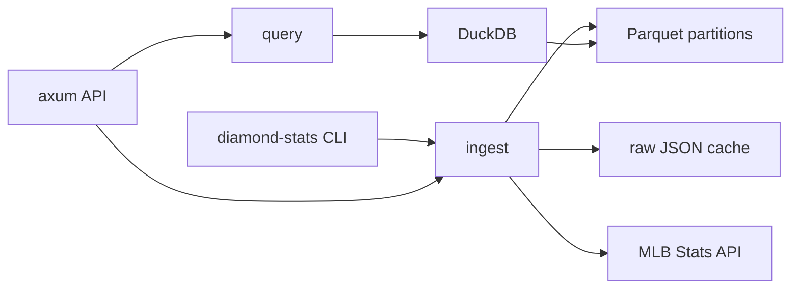

# diamond-stats

diamond-stats is a small Rust service for asking questions of MLB and Minor League season statistics. It downloads from the [MLB Stats API](https://statsapi.mlb.com/api/v1), normalizes the rows into Parquet, and answers through DuckDB and an HTTP API.

Milestone 1 loads **one MLB season and one Triple-A season** (2025): season hitting, season pitching, and team lists. A player's game log is fetched the first time you ask for it and then read from disk. The interesting query is a player who played at more than one level, or for more than one club, in the same year.

The code is open source. The statistics are not. See [Data & licensing](#data--licensing).

## Architecture



| Crate | Job |
| --- | --- |
| `diamond-stats-core` | Levels, domain rows, rate formulas, and serde models of the API. The wire types and the normalized types are separate. |
| `diamond-stats-ingest` | Async client (`reqwest`), on-disk cache, pacing, and Arrow/Parquet writes. A `StatsApi` trait so tests never open a socket. |
| `diamond-stats-query` | DuckDB over the Parquet files. Typed functions, parameters for every value that comes from a request. |
| `diamond-stats-api` | axum, OpenAPI via utoipa, structured tracing logs, one JSON error type. |
| `diamond-stats-cli` | `ingest` and `serve`. |

## Quickstart

You need a recent stable Rust. DuckDB is the official prebuilt shared library, downloaded when the `duckdb` crate builds. `cargo run` and `cargo test` put it on the loader path. A C++ compiler is not required.

```bash
cargo run -p diamond-stats-cli -- ingest --season 2025 --level mlb,aaa
cargo run -p diamond-stats-cli -- serve
```

`ingest` writes `data/cache` and `data/parquet`. Both are gitignored. A second run is served from the cache.

The server listens on `127.0.0.1:8080`. Swagger UI is at <http://127.0.0.1:8080/swagger-ui>.

```bash
curl -sS 'http://127.0.0.1:8080/v1/levels' | jq .
curl -sS 'http://127.0.0.1:8080/v1/leaders?season=2025&level=mlb&group=hitting&stat=hr&limit=5' \
  | jq '{stat, leaders: [.leaders[] | {rank, player_name, team_names, value}]}'
curl -sS 'http://127.0.0.1:8080/v1/leaders?season=2025&level=mlb&group=hitting&stat=avg&limit=5' \
  | jq '{stat, order, min_plate_appearances, leaders: [.leaders[] | {rank, player_name, team_names, value, plate_appearances}]}'
curl -sS 'http://127.0.0.1:8080/v1/leaders?season=2025&level=mlb&group=pitching&stat=era&limit=3' \
  | jq '{stat, order, min_innings, leaders: [.leaders[] | {rank, player_name, value, innings_pitched, outs}]}'
curl -sS 'http://127.0.0.1:8080/v1/players/701350/seasons' \
  | jq '[.batting[] | {level, team_name, games, home_runs, avg, api_avg}]'
curl -sS 'http://127.0.0.1:8080/v1/players/647304/seasons' \
  | jq '[.batting[] | {level, team_name, games, at_bats, hits, home_runs, avg, api_avg}]'
curl -sS 'http://127.0.0.1:8080/v1/players/592450/gamelog?season=2025&level=mlb&group=hitting' \
  | jq '{player_id, season, level, games: (.hitting | length), first: .hitting[0] | {game_date, game_pk, opponent_name, summary, hits, at_bats, home_runs}}'
```

Rate leaderboards default to a sample floor so a 1-for-1 hitter does not lead the league: 502 plate appearances for batting rates, 162 true innings for pitching rates. Counting stats have no floor. Pass `min_pa=0` or `min_ip=0` to remove it. `min_ip` is true innings (outs / 3), not baseball notation. ERA and WHIP sort ascending. `limit` is at most 50.

`value` is the unrounded quotient. `api_avg` on a player response is the number the Stats API printed. The outputs below are from a live 2025 ingest on 2026-11-19. `jq` only picks fields; it does not change them.

## Quickstart output

`ingest --season 2025 --level mlb,aaa` printed:

```text
ingested season 2025 into data
  mlb: 30 teams, 845 hitting stints (76 multi-team players hydrated), 1015 pitching stints (120 multi-team players hydrated)
  aaa: 30 teams, 1012 hitting stints (82 multi-team players hydrated), 1418 pitching stints (135 multi-team players hydrated)
game logs are fetched on the first /v1/players/{id}/gamelog request
```

Home run leaders. Eugenio Suárez is one row because his Arizona and Seattle stints were summed:

```json
{
  "stat": "hr",
  "leaders": [
    { "rank": 1, "player_name": "Cal Raleigh", "team_names": "Seattle Mariners", "value": 60.0 },
    { "rank": 2, "player_name": "Kyle Schwarber", "team_names": "Philadelphia Phillies", "value": 56.0 },
    { "rank": 3, "player_name": "Shohei Ohtani", "team_names": "Los Angeles Dodgers", "value": 55.0 },
    { "rank": 4, "player_name": "Aaron Judge", "team_names": "New York Yankees", "value": 53.0 },
    { "rank": 5, "player_name": "Eugenio Suárez", "team_names": "Arizona Diamondbacks | Seattle Mariners", "value": 49.0 }
  ]
}
```

Batting average, with the default 502 plate-appearance floor:

```json
{
  "stat": "avg",
  "order": "desc",
  "min_plate_appearances": 502,
  "leaders": [
    { "rank": 1, "player_name": "Aaron Judge", "team_names": "New York Yankees", "value": 0.33086876155268025, "plate_appearances": 679 },
    { "rank": 2, "player_name": "Bo Bichette", "team_names": "Toronto Blue Jays", "value": 0.31099656357388317, "plate_appearances": 628 },
    { "rank": 3, "player_name": "Jacob Wilson", "team_names": "Athletics", "value": 0.31069958847736623, "plate_appearances": 523 },
    { "rank": 4, "player_name": "George Springer", "team_names": "Toronto Blue Jays", "value": 0.3092369477911647, "plate_appearances": 586 },
    { "rank": 5, "player_name": "Jeremy Peña", "team_names": "Houston Astros", "value": 0.30425963488843816, "plate_appearances": 543 }
  ]
}
```

ERA, sorted ascending. `innings_pitched` is baseball notation; `value` uses outs/3. Skenes' `187.2` is 563 outs, and 9 × 41 / (563/3) is about 1.966, which the API prints as 1.97.

```json
{
  "stat": "era",
  "order": "asc",
  "min_innings": 162.0,
  "leaders": [
    { "rank": 1, "player_name": "Paul Skenes", "value": 1.9662522202486679, "innings_pitched": "187.2", "outs": 563 },
    { "rank": 2, "player_name": "Tarik Skubal", "value": 2.21160409556314, "innings_pitched": "195.1", "outs": 586 },
    { "rank": 3, "player_name": "Hunter Brown", "value": 2.4280575539568345, "innings_pitched": "185.1", "outs": 556 }
  ]
}
```

Roman Anthony, Triple-A then Boston in 2025:

```json
[
  { "level": "aaa", "team_name": "Worcester Red Sox", "games": 58, "home_runs": 10, "avg": 0.28773584905660377, "api_avg": 0.288 },
  { "level": "mlb", "team_name": "Boston Red Sox", "games": 71, "home_runs": 8, "avg": 0.2918287937743191, "api_avg": 0.292 }
]
```

Josh Naylor's two MLB stints. The sport-wide feed had collapsed these into one 147-game line labeled Seattle:

```json
[
  { "level": "mlb", "team_name": "Arizona Diamondbacks", "games": 93, "at_bats": 349, "hits": 102, "home_runs": 11, "avg": 0.2922636103151863, "api_avg": 0.292 },
  { "level": "mlb", "team_name": "Seattle Mariners", "games": 54, "at_bats": 194, "hits": 58, "home_runs": 9, "avg": 0.29896907216494845, "api_avg": 0.299 }
]
```

Aaron Judge's hitting game log, fetched on the first request (152 games) and served from Parquet on the second:

```json
{
  "player_id": 592450,
  "season": 2025,
  "level": "mlb",
  "games": 152,
  "first": {
    "game_date": "2025-03-27",
    "game_pk": 778557,
    "opponent_name": "Milwaukee Brewers",
    "summary": "1-4 | 2B, 2 K, RBI",
    "hits": 1,
    "at_bats": 4,
    "home_runs": 0
  }
}
```

## Data & licensing

**This repository is source code.** It is dual-licensed under the [MIT License](LICENSE-MIT) or the [Apache License 2.0](LICENSE-APACHE).

**Statistics from the MLB Stats API are not part of that license.** Every response from `statsapi.mlb.com` carries a copyright notice pointing at <http://gdx.mlb.com/components/copyright.txt>. The notice says:

> The accounts, descriptions, data and presentation in the referring page (the "Materials") are proprietary content of MLB Advanced Media, L.P ("MLBAM").
> Only individual, non-commercial, non-bulk use of the Materials is permitted and any other use of the Materials is prohibited without prior written authorization from MLBAM.
> Authorized users of the Materials are prohibited from using the Materials in any commercial manner other than as expressly authorized by MLBAM.

diamond-stats follows that boundary:

- The CLI and HTTP API return small results: one player, one roster, a short leaderboard.
- Raw responses and Parquet files stay on the machine that ran `ingest`. They are gitignored. Do not commit them and do not publish them.
- The server binds to loopback. Putting it on the public internet would be a bulk-redistribution problem, not a deployment detail.
- Tests use a handful of trimmed, labeled excerpts of real responses (`crates/core/fixtures/README.md`). That is so the tests can run offline. It is not a stats dump.

Later milestones will add two historical sources, under their own terms:

- **Lahman** is [CC BY-SA 3.0](https://creativecommons.org/licenses/by-sa/3.0/). Attribution is required, and share-alike applies to adaptations of that database.
- **Retrosheet** requires this notice wherever its information is used: "The information used here was obtained free of charge from and is copyrighted by Retrosheet. Interested parties may contact Retrosheet at www.retrosheet.org."

FanGraphs and Baseball-Reference are not sources. They are not scraped.

## Design notes

**Parquet and DuckDB, not Postgres.** The workload is a batch rewrite of a season followed by scans and group-bys. Columnar files match that, and DuckDB reads them in-process, so the quickstart has no database to install. Partitions are `season={year}/level={slug}`. The tradeoff is real: this is a single-writer layout. A partition is replaced by an atomic rename. Concurrent incremental updates, row-level edits, and multi-tenant auth would want Postgres. Milestone 1 does not do those things. Rate formulas stay in Rust, next to the tests, and DuckDB does the scan and the `SUM`. There is one definition of AVG and ERA.

**Raw models vs normalized rows.** The API sends rates as strings, including `.---` for "undefined" and `.667` with no leading zero. A sport-wide season row with `numTeams > 1` is a full-season total labeled with only one of the clubs. Innings are `whole.outs`, so `5.1` is five and one out, not 5.1. On a game log, ERA/WHIP/AVG are the season line *through that game*; the counting stats are the game. Serde types in `api_model` preserve that mess. Domain rows are counting stats plus rates recomputed from them. API rates are kept beside the recomputed ones so a caller can see the source.

**Multi-team seasons.** `GET /api/v1/stats?...&playerPool=all` returns one row per player. Josh Naylor's 2025 line is 147 games labeled Seattle with `numTeams: 2`. Asking `teamId=109` (Arizona) does not return him at all, even though he played 93 games there. `GET /api/v1/people/{id}/stats?stats=season` returns the combined row (no team) and one row per club. Ingest keeps single-team rows as stints and, when `numTeams > 1`, replaces that row with the people-endpoint stints. Leaderboards sum the stints and recompute the rate. A roster shows only that club's stint. Those people-endpoint stints do not include a position, so a hydrated row's `position` is null.

**Politeness and cache.** There is no published rate limit. The client sends a descriptive User-Agent, keeps at most two requests in flight, waits 100ms between starts, and retries 429 and 5xx with backoff. Successful JSON is stored under `data/cache` keyed by the URL. Re-runs do not hit the network for URLs already cached. `playerPool=all` is always set; the default pool is qualified players only.

**Game logs are lazy.** A 2025 MLB-plus-Triple-A season is a few hundred stat requests after multi-team hydration. A game log is another request per player per group. Milestone 1 does not crawl them. The first `GET /v1/players/{id}/gamelog` fetches that player, writes one Parquet file (even when the log is empty), and later reads are local.

**SQL.** Season, level, player, team, and thresholds are bound parameters. The stat to sort by is a closed enum. The only string inlined into SQL is the data-directory path, and it is rejected if it contains quotes. `read_parquet` is called with `hive_partitioning = false` because season and level are real columns; DuckDB would otherwise also invent them from the directory names.

**DuckDB linkage.** The `bundled` feature of the `duckdb` crate compiles DuckDB's C++ amalgamation, and its `parquet` feature forces that. The default crate feature downloads the official shared library instead, which already includes the Parquet reader. `cargo test` and `cargo run` stage that library on the dynamic loader path.

## Roadmap

- **M2.** Every active MiLB level (Double-A, High-A, Single-A, Rookie), plus play-by-play and box scores. `sportId` 21 is not the way to get "all minors"; a season query against it returns zero splits. `sportId` 15 is inactive and absent from `/sports`.
- **M3.** Lahman and Retrosheet for historical MLB, with the attribution and share-alike obligations above.
- **M4.** Splits and situational numbers that are not a column in the season line.
- **Later, maybe.** A text-to-SQL layer over the same typed schema. Not part of the query path until the tables and the licensing story are boring.

## Development

```bash
cargo fmt --all -- --check
cargo clippy --workspace --all-targets -- -D warnings
cargo test --workspace
```

Tests do not use the network. See [CONTRIBUTING.md](CONTRIBUTING.md).

