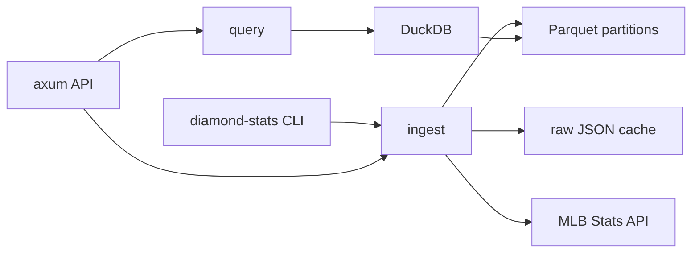

# diamond-stats

diamond-stats is a small Rust service for asking questions of MLB and Minor League statistics. It downloads from the [MLB Stats API](https://statsapi.mlb.com/api/v1), normalizes the rows into Parquet, and answers through DuckDB and an HTTP API.

Season lines cover **MLB, Triple-A, Double-A, High-A, Single-A, and Rookie** (`sportId` 1, 11, 12, 13, 14, and 16). A player's game log, a game's box score, and a game's play-by-play are fetched the first time you ask for them, then read from disk. The interesting season query is a player who played at more than one level, or for more than one club, in the same year.

The code is open source. The statistics are not. See [Data & licensing](#data--licensing).

## Getting started / Running the API

### Prerequisites

- Rust **stable**. `rust-toolchain.toml` selects stable, and the workspace `rust-version` is 1.88. These steps were run with `rustc 1.100.0` and `cargo 1.100.0`.
- A C++ compiler is not required. The `duckdb` crate downloads the official prebuilt shared library at build time. `cargo run` and `cargo test` put it on the loader path.
- `git`. `jq` is optional; the examples use it to pick fields.
- Network access for `ingest`. Tests do not use the network.

There is no required environment variable. `RUST_LOG` overrides the log filter (the default is `info`). `--data-dir` defaults to `data`. `--bind` defaults to `127.0.0.1:8080`.

### Clone and build

```bash
git clone https://github.com/Matt-mdlivingston/diamond-stats
cd diamond-stats
cargo run -p diamond-stats-cli -- --help
```

`cargo run` builds the workspace on first use. Raw JSON and Parquet go under `data/`, which is gitignored.

### Ingest a season

`ingest` writes season hitting, season pitching, and the club list for each level. `playerPool=all` and `gameType=R` are always set. Game logs, box scores, and play-by-play are not crawled here.

```bash
cargo run -p diamond-stats-cli -- ingest --season 2025 --level aa,high_a
```

A second run is served from `data/cache`. Levels are `mlb`, `aaa`, `aa`, `high_a`, `single_a`, and `rookie`.

That command printed:

```text
ingested season 2025 into data
  aa: 30 teams, 784 hitting stints (12 multi-team players hydrated), 1041 pitching stints (24 multi-team players hydrated)
  high_a: 30 teams, 803 hitting stints (14 multi-team players hydrated), 1058 pitching stints (18 multi-team players hydrated)
game logs are fetched on the first /v1/players/{id}/gamelog request
```

The sport-wide feed had 772 Double-A hitters and 789 High-A hitters. The extra stints are players who changed clubs; their combined row was replaced with one line per team.

### Ingest a day's games

`ingest-games` stores the regular-season schedule for the date, then the box score and play-by-play for final games. Postponed games stay on the schedule and are not downloaded. `--limit` caps how many final games are fetched. Omit it to fetch every final game that day.

```bash
cargo run -p diamond-stats-cli -- ingest-games \
  --season 2025 --level mlb,aaa,aa,high_a,single_a,rookie \
  --date 2025-06-21 --limit 2
```

On 2026-11-19 that printed:

```text
schedule 2025-06-21 mlb: 15 games (15 final), wrote box scores and play-by-play for 2
  game 777410: 27 batting lines, 8 pitching lines, 73 plate appearances, 276 pitches (276 with velocity, 276 with pitch type)
  game 777411: 30 batting lines, 8 pitching lines, 77 plate appearances, 298 pitches (298 with velocity, 298 with pitch type)
schedule 2025-06-21 aaa: 15 games (15 final), wrote box scores and play-by-play for 2
  game 779548: 28 batting lines, 10 pitching lines, 69 plate appearances, 275 pitches (275 with velocity, 275 with pitch type)
  game 779618: 27 batting lines, 8 pitching lines, 78 plate appearances, 317 pitches (317 with velocity, 317 with pitch type)
schedule 2025-06-21 aa: 16 games (16 final), wrote box scores and play-by-play for 2
  game 781861: 26 batting lines, 8 pitching lines, 75 plate appearances, 297 pitches (0 with velocity, 0 with pitch type)
  game 781931: 25 batting lines, 7 pitching lines, 75 plate appearances, 295 pitches (0 with velocity, 0 with pitch type)
schedule 2025-06-21 high_a: 15 games (14 final), wrote box scores and play-by-play for 2
  game 783864: 25 batting lines, 7 pitching lines, 75 plate appearances, 294 pitches (0 with velocity, 0 with pitch type)
  game 783928: 26 batting lines, 7 pitching lines, 78 plate appearances, 304 pitches (0 with velocity, 0 with pitch type)
schedule 2025-06-21 single_a: 15 games (15 final), wrote box scores and play-by-play for 2
  game 785507: 24 batting lines, 5 pitching lines, 60 plate appearances, 222 pitches (222 with velocity, 222 with pitch type)
  game 785716: 27 batting lines, 8 pitching lines, 93 plate appearances, 327 pitches (327 with velocity, 327 with pitch type)
schedule 2025-06-21 rookie: 41 games (41 final), wrote box scores and play-by-play for 2
  game 807159: 25 batting lines, 7 pitching lines, 82 plate appearances, 330 pitches (0 with velocity, 0 with pitch type)
  game 807188: 25 batting lines, 6 pitching lines, 62 plate appearances, 264 pitches (0 with velocity, 0 with pitch type)
```

Double-A had 16 games because of a doubleheader. High-A had 14 finals because one game was postponed. The two lowest `gamePk`s are what `--limit 2` keeps. Pitch type and velocity were on every pitch at MLB, Triple-A, and these two Single-A games, and on none of the Double-A, High-A, or Rookie pitches. Plate appearances and the umpire's call were present at every level.

### Start the API

```bash
cargo run -p diamond-stats-cli -- serve --bind 127.0.0.1:8080 --data-dir data
```

The process listens on `127.0.0.1:8080`. OpenAPI JSON is at <http://127.0.0.1:8080/api-docs/openapi.json>. Swagger UI is at <http://127.0.0.1:8080/swagger-ui/> (`/swagger-ui` redirects there).

### Example requests

Season home-run leaders at Double-A. Counting stats are summed across stints before the sort:

```bash
curl -sS 'http://127.0.0.1:8080/v1/leaders?season=2025&level=aa&group=hitting&stat=hr&limit=5' \
  | jq '{stat, order, level, leaders: [.leaders[] | {rank, player_name, team_names, value}]}'
```

```json
{
  "stat": "hr",
  "order": "desc",
  "level": "aa",
  "leaders": [
    { "rank": 1, "player_name": "Kala'i Rosario", "team_names": "Wichita Wind Surge", "value": 25.0 },
    { "rank": 2, "player_name": "Ryan Clifford", "team_names": "Binghamton Rumble Ponies", "value": 24.0 },
    { "rank": 3, "player_name": "Ruben Ibarra", "team_names": "Chattanooga Lookouts", "value": 21.0 },
    { "rank": 4, "player_name": "Tyler Hardman", "team_names": "Somerset Patriots", "value": 20.0 },
    { "rank": 5, "player_name": "BJ Murray Jr.", "team_names": "Knoxville Smokies", "value": 20.0 }
  ]
}
```

James Tibbs III's 2025 season across levels. Leave `level` off to see every ingested stint. Pass `level=aa` to keep one level:

```bash
curl -sS 'http://127.0.0.1:8080/v1/players/696486/seasons?season=2025' \
  | jq '{player_name, batting: [.batting[] | {level, team_name, games, at_bats, hits, home_runs, avg}]}'
```

```json
{
  "player_name": "James Tibbs III",
  "batting": [
    { "level": "aa", "team_name": "Tulsa Drillers", "games": 36, "at_bats": 134, "hits": 36, "home_runs": 7, "avg": 0.26865671641791045 },
    { "level": "aa", "team_name": "Portland Sea Dogs", "games": 30, "at_bats": 116, "hits": 24, "home_runs": 1, "avg": 0.20689655172413793 },
    { "level": "high_a", "team_name": "Eugene Emeralds", "games": 57, "at_bats": 207, "hits": 51, "home_runs": 12, "avg": 0.2463768115942029 }
  ]
}
```

Kala'i Rosario's Double-A game log. The first request fetches it (130 games) and writes Parquet. The second read does not call the Stats API:

```bash
curl -sS 'http://127.0.0.1:8080/v1/players/693850/gamelog?season=2025&level=aa&group=hitting' \
  | jq '{player_id, season, level, games: (.hitting | length), first: .hitting[0] | {game_date, game_pk, opponent_name, summary, hits, at_bats, home_runs}}'
```

```json
{
  "player_id": 693850,
  "season": 2025,
  "level": "aa",
  "games": 130,
  "first": {
    "game_date": "2025-04-05",
    "game_pk": 781967,
    "opponent_name": "Springfield Cardinals",
    "summary": "0-3 | BB, 2 K",
    "hits": 0,
    "at_bats": 3,
    "home_runs": 0
  }
}
```

Schedule, then one box score. `batting_order` is the Stats API code: `100` is the first slot, `200` the second. `avg` is recomputed from that game's hits and at-bats.

```bash
curl -sS 'http://127.0.0.1:8080/v1/games?season=2025&level=mlb&date=2025-06-21' \
  | jq '{date, games: (.games | length), first: .games[0] | {game_pk, away_team_name, away_score, home_team_name, home_score, venue_name}}'
curl -sS 'http://127.0.0.1:8080/v1/games/777410' \
  | jq '{matchup: "\(.game.away_team_name) \(.game.away_score) @ \(.game.home_team_name) \(.game.home_score)", boxscore_loaded, batters: (.batting | length), pitchers: (.pitching | length), first: .batting[0] | {player_name, position, batting_order, at_bats, hits, avg}}'
```

```json
{
  "date": "2025-06-21",
  "games": 15,
  "first": {
    "game_pk": 777410,
    "away_team_name": "Arizona Diamondbacks",
    "away_score": 5,
    "home_team_name": "Colorado Rockies",
    "home_score": 3,
    "venue_name": "Coors Field"
  }
}
```

```json
{
  "matchup": "Arizona Diamondbacks 5 @ Colorado Rockies 3",
  "boxscore_loaded": true,
  "batters": 27,
  "pitchers": 8,
  "first": {
    "player_name": "Ketel Marte",
    "position": "2B",
    "batting_order": 100,
    "at_bats": 4,
    "hits": 4,
    "avg": 1.0
  }
}
```

Play-by-play. The MLB game has pitch type and velocity. The Double-A game has the sequence and the call, and nulls where the feed sent neither type nor speed:

```bash
curl -sS 'http://127.0.0.1:8080/v1/games/777410/plays' \
  | jq '{pitch_tracking, pitch_tracking_note, first: .plate_appearances[0] | {batter_name, pitcher_name, event, pitches: [.pitches[:1][] | {pitch_number, call_code, pitch_type_code, start_speed}]}}'
curl -sS 'http://127.0.0.1:8080/v1/games/781861/plays' \
  | jq '{level, pitch_tracking, pitch_tracking_note, first: .plate_appearances[0] | {batter_name, pitcher_name, event, pitches: [.pitches[:1][] | {pitch_number, call_code, pitch_type_code, start_speed}]}}'
```

```json
{
  "pitch_tracking": { "plate_appearances": 73, "pitches": 276, "pitches_with_velocity": 276, "pitches_with_pitch_type": 276 },
  "pitch_tracking_note": "Pitch type and velocity were present on every pitch in this feed.",
  "first": {
    "batter_name": "Ketel Marte",
    "pitcher_name": "Carson Palmquist",
    "event": "Double",
    "pitches": [{ "pitch_number": 1, "call_code": "F", "pitch_type_code": "FF", "start_speed": 90.2 }]
  }
}
```

```json
{
  "level": "aa",
  "pitch_tracking": { "plate_appearances": 75, "pitches": 297, "pitches_with_velocity": 0, "pitches_with_pitch_type": 0 },
  "pitch_tracking_note": "Pitch sequence and umpire calls are present. The Stats API did not send pitch type or velocity for these pitches.",
  "first": {
    "batter_name": "Cole Conn",
    "pitcher_name": "Jackson Ferris",
    "event": "Walk",
    "pitches": [{ "pitch_number": 1, "call_code": "B", "pitch_type_code": null, "start_speed": null }]
  }
}
```

Batter versus pitcher, over the games whose plays are already stored. This does not download the rest of the season:

```bash
curl -sS 'http://127.0.0.1:8080/v1/matchups?season=2025&level=mlb&batter_id=606466&pitcher_id=687223' \
  | jq '{note, plate_appearances: [.plate_appearances[] | {inning, event, description}]}'
```

```json
{
  "note": "Only games whose play-by-play has been ingested are included.",
  "plate_appearances": [
    { "inning": 1, "event": "Double", "description": "Ketel Marte doubles (10) on a sharp line drive to center fielder Sam Hilliard." },
    { "inning": 2, "event": "Double", "description": "Ketel Marte hits a ground-rule double (11) on a fly ball to left-center field. Tim Tawa scores." }
  ]
}
```

`GET /v1/games/{gamePk}` and `GET /v1/games/{gamePk}/plays` also fetch a final game that is not on disk yet. A date listing does not download every box score.

### Tests, formatting, and clippy

```bash
cargo fmt --all -- --check
cargo clippy --workspace --all-targets -- -D warnings
cargo test --workspace
cargo deny --workspace check
```

`cargo test` does not use the network. CI runs `cargo deny` 0.21 with `--workspace` in front of `check`. See [CONTRIBUTING.md](CONTRIBUTING.md).

## Architecture



Season lines, schedules, box scores, and plays are separate Parquet datasets under `data/parquet`. A date schedule is one file. A box score, its plays, and its pitches are one file per game. DuckDB opens them with `hive_partitioning = false`.

| Crate | Job |
| --- | --- |
| `diamond-stats-core` | Levels, domain rows, rate formulas, and serde models of the API. The wire types and the normalized types are separate. |
| `diamond-stats-ingest` | Async client (`reqwest`), on-disk cache, pacing, and Arrow/Parquet writes. A `StatsApi` trait so tests never open a socket. |
| `diamond-stats-query` | DuckDB over the Parquet files. Typed functions, parameters for every value that comes from a request. |
| `diamond-stats-api` | axum, OpenAPI via utoipa, structured tracing logs, one JSON error type. |
| `diamond-stats-cli` | `ingest`, `ingest-games`, and `serve`. |

## MLB 2025 rate leaderboards

These rows are from `ingest --season 2025 --level mlb,aaa` on 2026-11-19, kept so the rate-stat rules have a full major-league example. Rate leaderboards default to a sample floor: 502 plate appearances for batting rates, 162 true innings for pitching rates. Counting stats have no floor. Pass `min_pa=0` or `min_ip=0` to remove it. `min_ip` is true innings (outs / 3), not baseball notation. ERA and WHIP sort ascending. `limit` is at most 50. `value` is the unrounded quotient.

Home run leaders. Eugenio Suárez is one row because his Arizona and Seattle stints were summed:

```json
{
  "stat": "hr",
  "leaders": [
    { "rank": 1, "player_name": "Cal Raleigh", "team_names": "Seattle Mariners", "value": 60.0 },
    { "rank": 2, "player_name": "Kyle Schwarber", "team_names": "Philadelphia Phillies", "value": 56.0 },
    { "rank": 3, "player_name": "Shohei Ohtani", "team_names": "Los Angeles Dodgers", "value": 55.0 },
    { "rank": 4, "player_name": "Aaron Judge", "team_names": "New York Yankees", "value": 53.0 },
    { "rank": 5, "player_name": "Eugenio Suárez", "team_names": "Arizona Diamondbacks | Seattle Mariners", "value": 49.0 }
  ]
}
```

Batting average, with the default 502 plate-appearance floor:

```json
{
  "stat": "avg",
  "order": "desc",
  "min_plate_appearances": 502,
  "leaders": [
    { "rank": 1, "player_name": "Aaron Judge", "team_names": "New York Yankees", "value": 0.33086876155268025, "plate_appearances": 679 },
    { "rank": 2, "player_name": "Bo Bichette", "team_names": "Toronto Blue Jays", "value": 0.31099656357388317, "plate_appearances": 628 },
    { "rank": 3, "player_name": "Jacob Wilson", "team_names": "Athletics", "value": 0.31069958847736623, "plate_appearances": 523 },
    { "rank": 4, "player_name": "George Springer", "team_names": "Toronto Blue Jays", "value": 0.3092369477911647, "plate_appearances": 586 },
    { "rank": 5, "player_name": "Jeremy Peña", "team_names": "Houston Astros", "value": 0.30425963488843816, "plate_appearances": 543 }
  ]
}
```

ERA, sorted ascending. `innings_pitched` is baseball notation; `value` uses outs/3. Skenes' `187.2` is 563 outs, and 9 × 41 / (563/3) is about 1.966, which the API prints as 1.97.

```json
{
  "stat": "era",
  "order": "asc",
  "min_innings": 162.0,
  "leaders": [
    { "rank": 1, "player_name": "Paul Skenes", "value": 1.9662522202486679, "innings_pitched": "187.2", "outs": 563 },
    { "rank": 2, "player_name": "Tarik Skubal", "value": 2.21160409556314, "innings_pitched": "195.1", "outs": 586 },
    { "rank": 3, "player_name": "Hunter Brown", "value": 2.4280575539568345, "innings_pitched": "185.1", "outs": 556 }
  ]
}
```

Roman Anthony, Triple-A then Boston in 2025:

```json
[
  { "level": "aaa", "team_name": "Worcester Red Sox", "games": 58, "home_runs": 10, "avg": 0.28773584905660377, "api_avg": 0.288 },
  { "level": "mlb", "team_name": "Boston Red Sox", "games": 71, "home_runs": 8, "avg": 0.2918287937743191, "api_avg": 0.292 }
]
```

`ingest --season 2025 --level mlb,aaa` wrote 30 teams at each level, 845 MLB hitting stints (76 multi-team players hydrated), 1015 MLB pitching stints (120 hydrated), 1012 Triple-A hitting stints (82 hydrated), and 1418 Triple-A pitching stints (135 hydrated).

## Data & licensing

**This repository is source code.** It is dual-licensed under the [MIT License](LICENSE-MIT) or the [Apache License 2.0](LICENSE-APACHE).

**Statistics from the MLB Stats API are not part of that license.** Every response from `statsapi.mlb.com` carries a copyright notice pointing at <http://gdx.mlb.com/components/copyright.txt>. The notice says:

> The accounts, descriptions, data and presentation in the referring page (the "Materials") are proprietary content of MLB Advanced Media, L.P ("MLBAM").
> Only individual, non-commercial, non-bulk use of the Materials is permitted and any other use of the Materials is prohibited without prior written authorization from MLBAM.
> Authorized users of the Materials are prohibited from using the Materials in any commercial manner other than as expressly authorized by MLBAM.

diamond-stats follows that boundary:

- The CLI and HTTP API return small results: one player, one roster, one game, a short leaderboard.
- Raw responses and Parquet files stay on the machine that ran `ingest`. They are gitignored. Do not commit them and do not publish them.
- The server binds to loopback. Putting it on the public internet would be a bulk-redistribution problem, not a deployment detail.
- Tests use a handful of trimmed, labeled excerpts of real responses (`crates/core/fixtures/README.md`). That is so the tests can run offline. It is not a stats dump.

Later milestones will add two historical sources, under their own terms:

- **Lahman** is [CC BY-SA 3.0](https://creativecommons.org/licenses/by-sa/3.0/). Attribution is required, and share-alike applies to adaptations of that database.
- **Retrosheet** requires this notice wherever its information is used: "The information used here was obtained free of charge from and is copyrighted by Retrosheet. Interested parties may contact Retrosheet at www.retrosheet.org."

FanGraphs and Baseball-Reference are not sources. They are not scraped.

## Design notes

**Parquet and DuckDB, not Postgres.** The workload is a batch rewrite of a season, or of one game, followed by scans and group-bys. Columnar files match that, and DuckDB reads them in-process, so the quickstart has no database to install. Partitions are `season={year}/level={slug}`. A schedule date is `date={YYYY-MM-DD}.parquet`. A game's box score, plays, and pitches are `game={gamePk}.parquet`. The tradeoff is real: this is a single-writer layout. A file is replaced by an atomic rename. Concurrent incremental updates, row-level edits, and multi-tenant auth would want Postgres. Rate formulas stay in Rust, next to the tests, and DuckDB does the scan and the `SUM`. There is one definition of AVG, ERA, and WHIP, including on a box score.

**Raw models vs normalized rows.** The API sends rates as strings, including `.---` for "undefined" and `.667` with no leading zero. A sport-wide season row with `numTeams > 1` is a full-season total labeled with only one of the clubs. Innings are `whole.outs`, so `5.1` is five and one out, not 5.1. The box score uses the same notation: `inningsPitched` is a string and `outs` is an integer. On a game log, ERA/WHIP/AVG are the season line *through that game*; the counting stats are the game. Serde types preserve that mess. Domain rows are counting stats plus rates recomputed from them.

**Six levels, one season path.** `GET /api/v1/stats` with `playerPool=all` and `gameType=R` returns the same stat object at sportIds 1, 11, 12, 13, 14, and 16. A `limit=1` probe on 2026-11-19 reported these hitting populations and club counts: MLB 765 players / 30 teams, Triple-A 920 / 30, Double-A 772 / 30, High-A 789 / 30, Single-A 922 / 30, Rookie 1579 / 82. Rookie is three leagues under sportId 16: Dominican Summer League (52), Arizona Complex League (15), and Florida Complex League (15). It is not one league. Multi-team hydration is the same request as in the majors. The 2025 Double-A ingest replaced 12 hitting rows and 24 pitching rows; High-A replaced 14 and 18. The default sort is not a qualified-player list. The first High-A row in that probe was Jesse Winker, one game for Brooklyn, `numTeams` 1. That is a real High-A stint.

**`sportId` 15 and 21 are not levels.** 15 is inactive and absent from `/sports`. 21 ("Minor League Baseball") is active and returns `totalSplits: 0` for a season query. Passing `minors` or `21` is an error.

**Multi-team seasons.** `GET /api/v1/stats?...&playerPool=all` returns one row per player. Asking for one `teamId` does not return a player whose combined row was labeled with the other club. `GET /api/v1/people/{id}/stats?stats=season` returns the combined row (no team) and one row per club. Ingest keeps single-team rows as stints and, when `numTeams > 1`, replaces that row with the people-endpoint stints. Leaderboards sum the stints and recompute the rate. `GET /v1/players/{id}/seasons` returns every ingested stint. `season` and `level` on that route are filters. Omit `level` for the cross-level view.

**Schedule quirks.** `gameType=R` is required. On 2025-07-15, the All-Star date, that filter returned zero games for sportIds 1, 11, 12, 13, and 14. The major-league game that day is `gameType=A`. Rookie complex leagues still played (44 games). A postponed game can say `abstractGameState=Final` while `codedGameState` is `D` and `detailedState` is `Postponed`, with no score. Game 789134 was on the 2025-06-21 High-A schedule and its `officialDate` had already moved to 2025-07-24. The schedule file keeps both dates. Box scores and play-by-play are requested only when the coded state is `F` or the detailed state is `Final`, so a postponed line is not cached. The schedule's team object has id and name, not `sport`. A lookup by `gamePk` learns the level from `GET /api/v1/teams?teamId=&season=`. The box score's team object does include `sport.id`.

**Play-by-play coverage.** Every game sampled on 2025-06-21 had plate appearances, descriptions, and pitch events with an umpire call. Pitch type and release speed are a different question, and they are not a clean "minors don't have them" rule:

- MLB and Triple-A: both fields on every pitch in the games fetched here.
- Double-A, High-A, and Rookie (Florida Complex, and separate Arizona Complex and Dominican Summer League games checked the same day): calls present, type and velocity absent. `pitchData` still has a strike zone.
- Single-A, same date: games 785507 and 785716 had type and velocity on every pitch. Games 786767 and 786176 had neither.

Nulls are stored as nulls. Each plays response includes `pitch_tracking` counts and a note written from those counts.

**Politeness and cache.** There is no published rate limit. The client sends a descriptive User-Agent, keeps at most two requests in flight, waits 100ms between starts, and retries 429 and 5xx with backoff. Successful JSON is stored under `data/cache` keyed by the URL. The cache is not refreshed. That is why box scores and play-by-play are requested only for final games: a mid-game body would stick. Delete `data/cache` to force a refetch. `playerPool=all` is always set; the default pool is qualified players only.

**Game logs, boxes, and plays are lazy.** Season ingest does not crawl them. The first matching GET fetches that one player or that one final game. `ingest-games` is the explicit path for a date. `GET /v1/matchups` reads plate appearances already on disk. It does not walk a season of games. Pass at least one of `batter_id` or `pitcher_id`. `limit` defaults to 50 and stops at 200.

**SQL.** Season, level, player, team, game, date, and thresholds are bound parameters. The stat to sort by is a closed enum. The only string inlined into SQL is the data-directory path, and it is rejected if it contains quotes. Dates must be `YYYY-MM-DD` before they become a filename. `read_parquet` is called with `hive_partitioning = false` because season and level are real columns; DuckDB would otherwise also invent them from the directory names.

**DuckDB linkage.** The `bundled` feature of the `duckdb` crate compiles DuckDB's C++ amalgamation, and its `parquet` feature forces that. The default crate feature downloads the official shared library instead, which already includes the Parquet reader. `cargo test` and `cargo run` stage that library on the dynamic loader path.

## Roadmap

- **M2.** Shipped here: every active full-season and complex level (Double-A, High-A, Single-A, Rookie), box scores, and play-by-play.
- **M3.** Lahman and Retrosheet for historical MLB, with the attribution and share-alike obligations above.
- **M4.** Splits and situational numbers that are not a column in the season line.
- **Later, maybe.** A text-to-SQL layer over the same typed schema. Not part of the query path until the tables and the licensing story are boring.

## Development

```bash
cargo fmt --all -- --check
cargo clippy --workspace --all-targets -- -D warnings
cargo test --workspace
cargo deny --workspace check
```

Tests do not use the network. See [CONTRIBUTING.md](CONTRIBUTING.md).
